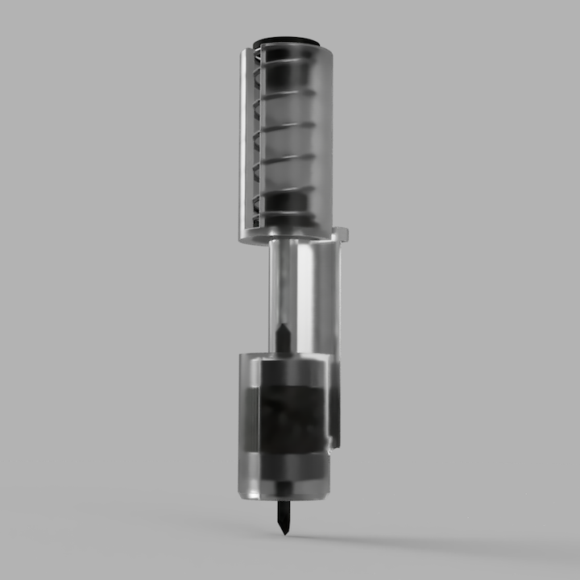
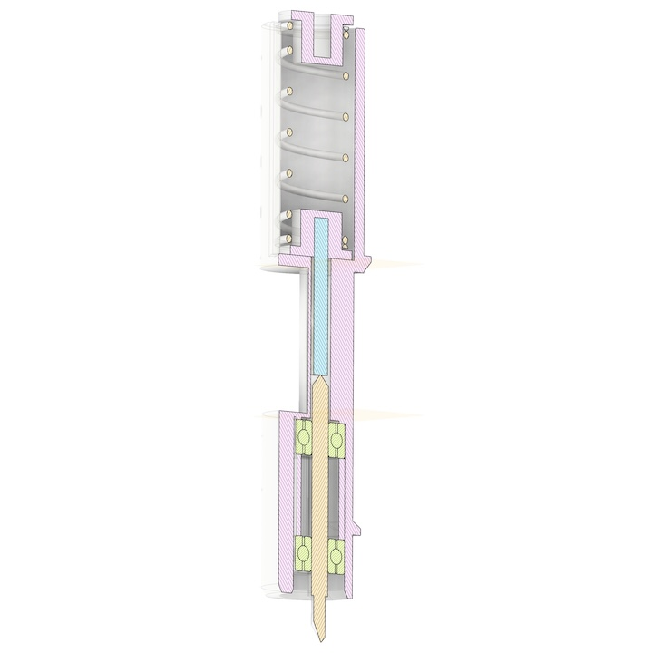
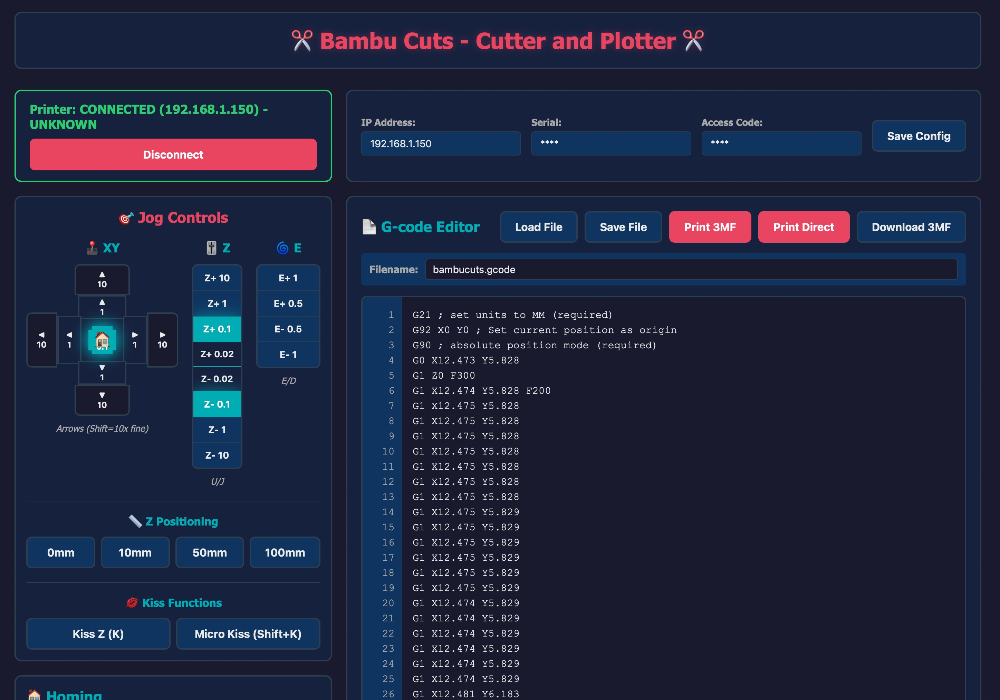

# Bambu Cuts - Cutter and Plotter for Bambu Lab Printers

Control your Bambu Lab 3D printer as a CNC cutter or plotter. Convert SVG/DXF files to G-code and execute them with a web-based control interface.


# WARNING

This can brake your printer, or you, or your cat, or all of the above. Especially if you put a knife on your printer. Using this software there will be no hard limits of the printer movements, make sure your gcode is reasonable. 


The origin of the print is at the current tool head position for X and Y. 
The Z=0 is set with the jogger, always make sure the Z is correctly zeroes. Otherwise it can plunge the knife into the print bed.

The printer needs to be in LAN mode with developer options enabled, or run an older firmware (1.0.4 worked for me)

## TLDR
   ```
   pip install git+https://github.com/unrelatedlabs/bambu-cuts.git
   bambucuts server
   ```

## Demo


*ploting on fabric*


*cutting a sticker with a drag knife*





*3D printed pen holder for plotting operations*


## Assembling the cutter 



Print in PETG! PLA tends to creep more. 

Parts: 
 - 2mm ID 6mm OD 3mm deep bearing 2x. https://amzn.to/46W4Ju7
 - roland style 2mm shaft blades https://amzn.to/4gY9w2Q 
 - 7mm OD, 20mm long spring https://amzn.to/4mQEISK
 - 1.7mm diameter 13mm long steel rod. (I cut a nail to size)
 - a small magnet to hold the blade. I've attached it on the clamp after the cutter is mounted on the printer. 


 The cutter assembly fits in the place of the hot end. Insert to a piece of filament to control the spring tension with the extruder.


## Features




- 🎮 **Web-based Control Interface** - Jog controls, G-code editor, and live monitoring
- ✂️ **SVG/DXF to G-code Conversion** - Convert vector graphics to cutting paths


*Detailed cross-section view of the cutter mechanism*
- 🖥️ **CLI Tools** - Command-line utilities for batch processing


*3D printed pen holder for plotting operations*
- 🔄 **3MF Integration** - Automatically packages G-code for Bambu Lab printers

## Installation

### From Source

```bash
git clone git@github.com:unrelatedlabs/bambu-cuts.git
cd bambu-cuts
pip install -e .
```

## Quick Start

### Option 1: Run Without Installing (Development)

**Quick Start (Linux/Mac):**
```bash
./run.sh
```

**Manual Setup:**
```bash
# Create and activate virtual environment
python3 -m venv .venv
source .venv/bin/activate  # On Windows: .venv\Scripts\activate

# Install dependencies
pip install -r requirements.txt

# Run the server directly
python -m bambucuts.webui.app
```

Open http://localhost:5425 in your browser.

### Option 2: Run with Docker

```bash
# Build the Docker image
docker build -t bambucuts .

# Run the container (interactive for first-time config)
docker run -it -p 5425:5425 bambucuts

# Or run with existing config (non-interactive)
docker run -p 5425:5425 -v ~/.bambucuts.conf:/root/.bambucuts.conf bambucuts
```

**Note:** Use `-it` flag on first run to interactively enter printer configuration. After configuration is saved, you can mount the config file with `-v` flag for subsequent runs.

Open http://localhost:5425 in your browser.

### Option 3: Install and Use CLI

After installation with `pip install -e .`:

```bash
bambucuts server
```

On first run, you'll be prompted for your printer configuration. Configuration is saved to `~/.bambucuts.conf`.
For more than one printer, see [Multiple printers](#multiple-printers).

Open http://localhost:5425 in your browser.

### 3. Convert SVG to G-code

```bash
bambucuts svg2gcode input.svg -o output.gcode
```

### 4. Convert DXF to SVG

```bash
bambucuts dxf2svg input.dxf -o output.svg
```

## Multiple printers

Each printer gets a **profile**, and each profile its own config file:

| Profile | Config file |
| --- | --- |
| default | `~/.bambucuts.conf` |
| `mini` | `~/.bambucuts.mini.conf` |

Run one server instance per printer. Each profile serves on its own port
without being told to: the default profile takes 5425 and every other profile
the next free port up, so a second printer lands on 5426.

```bash
bambucuts server                 # default profile  ->  http://localhost:5425
bambucuts server --profile mini  # second profile   ->  http://localhost:5426
bambucuts server --profile mini --port 5500   # or pick one yourself
```

A profile that is asked for but has no config file prompts for the printer's IP,
serial and access code, then saves them under that profile together with the
port it picked, so that port stays put as more profiles are added.
`bambucuts profiles` lists what you have, with the port each one serves on.

The profile's config file holds that `port` and an optional `name`, shown in the
page title and header so two open tabs stay tellable apart:

```json
{
  "ip": "192.168.1.17",
  "serial": "0309CA480901636",
  "access_code": "12345678",
  "name": "X1 downstairs",
  "port": 5426
}
```

Then each instance is just:

```bash
bambucuts server --profile mini
bambucuts server --profile x1
```

`--port` beats the config file, which beats the port derived from the profile.

Other ways to pick the profile:

```bash
./run.sh x1                                   # run.sh <profile> [port]
BAMBUCUTS_PROFILE=x1 python -m bambucuts.webui.app
python -m bambucuts.webui.app --profile x1 --port 5426
bambucuts --profile x1 mqtt-dump              # works for every subcommand
```

With Docker, give each container its own config file and port:

```bash
docker run -p 5426:5425 -v ~/.bambucuts.x1.conf:/root/.bambucuts.conf bambucuts
```

Each instance holds its own printer connection, MQTT listener and head-position
tracking, so the two never share state.

## CLI Commands

- `bambucuts server` - Start web interface
- `bambucuts profiles` - List configured printer profiles
- `bambucuts svg2gcode INPUT` - Convert SVG to G-code
- `bambucuts dxf2svg INPUT` - Convert DXF to SVG
- `bambucuts mqtt-dump` - Dump raw Bambu MQTT printer report messages

`--profile NAME` selects which printer any of these talk to.
Run `bambucuts --help` for full options.

## Debugging printer MQTT reports

To inspect the raw status payload from the printer:

```bash
bambucuts mqtt-dump --seconds 5 --count 5
```

The terminal output prints each report as it arrives. To keep listening:

```bash
bambucuts mqtt-dump --follow
```

For machine-readable live output:

```bash
bambucuts mqtt-dump --follow --ndjson
```

When the web server is running, the same dump is also available at:

```bash
curl "http://localhost:5425/api/mqtt-dump?seconds=5&count=5"
```

For streaming newline-delimited JSON:

```bash
curl -N "http://localhost:5425/api/mqtt-stream?seconds=60&count=0"
```

## G-code progress over MQTT

`M73 P<percent> R<remaining>` updates the printer's MQTT progress fields, such as `mc_percent` and `mc_remaining_time`.

When G-code is sent from the web UI, Bambu Cuts appends one done marker after the last command:

```gcode
M400
M73 P43 R0
```

With the laser board connected it appends a faster marker instead and sends no `M73` at all — see [the side channel](#faster-done-signal-the-laser-board-side-channel) below:

```gcode
M400
M620 R201 M621 R201
```

`M400` waits for all queued motion to finish before the `M73` runs, so seeing that exact `mc_percent` with `mc_remaining_time` = 0 in MQTT means the whole batch has completed. The percent is chosen as the printer's current `mc_percent` + 1 so it always produces a fresh MQTT delta. Only a single marker is used, because every `M400` forces the planner to a full stop, which would leave a pen dwell or laser spot at each checkpoint.

`Print Direct` has a `Single call` checkbox. Unchecked (default), each line is published as its own MQTT `gcode_line` command with a 50 ms gap between them. Checked, all lines are joined with newlines and published in a single `gcode_line` command, which is much faster to queue but sends one large MQTT payload the printer may reject if it is too big.

For `Print Direct`, the web UI tracks the active direct job separately. The send action only means the G-code was queued; the job is marked `complete` the moment the MQTT listener sees the final marker, whether or not a browser is polling. While a job is active the listener also sends the printer a `pushall` request twice per second, which keeps the printer emitting a full report about once per second instead of on its own multi-second cadence. The printer never answers faster than once per second however often it is asked, and rates of 10 Hz or more measured slightly slower detection. If the marker does not arrive within the estimated run time × 1.5 (minimum 30 s), the job is marked `stalled`. The estimate sums move distance divided by the modal feed rate plus `G4` dwells, ignoring acceleration, and starts from the position the previous direct send left the head at. Jobs are queryable at `/api/gcode/jobs` and `/api/gcode/jobs/<id>`.

Several direct jobs can be in flight at once. Each new job's marker continues the counter from the newest queued job, and a report matching a later job also completes every job queued before it, so a marker the printer's once-per-second reporting skipped cannot strand a job. Deadlines chain, so a job's timeout starts where the previous job's deadline ends. The send endpoint takes two extra options:

- `"m400": false` drops the motion wait before the marker. Use it for every batch that has another batch queued behind it, so the pen never stops; keep the default `true` on the final batch so its done signal is exact.
- `"wait": true` blocks the request until the job completes, stalls, or `wait_seconds` pass (default: the job's own timeout plus a margin), and returns the final job state with `completed` set.

Measured on an A1 drawing three 60 mm circles as four quarter batches each: waiting for each batch's done signal before sending the next took 63 to 73 s; queueing the quarters back to back with `m400: false` on the first three and `wait: true` on the last took 38.7 s against 33.9 s of pure motion, and every batch still reported its own marker.

### Done-signal latency benchmark

To measure how long the done signal takes to arrive after queueing, run the benchmark with the printer connected. Each iteration parks the head at X10 Y10 as its own job, then times a fresh job that moves to X110 Y110 in 1 line and again in 10 lines, and reports min/max/mean/median/stdev for queue time, wait time, and overhead (wait minus estimated motion time):

```bash
curl -X POST http://localhost:5425/api/gcode/benchmark \
  -H 'Content-Type: application/json' \
  -d '{"iterations": 10, "line_counts": [1, 10], "feed_rate": 3000, "single_call": true}'
curl http://localhost:5425/api/gcode/benchmark      # progress and results
curl -X POST http://localhost:5425/api/gcode/benchmark/stop
```

The head must have clear travel between those points and Z is not touched, so lift the pen first. Add `"distance_mm": 0` to make the measured batch a zero-motion move, which isolates the printer's command and reporting latency from motion time, and `"pushall_interval": 0.5` to try a different status request rate.

`POST /api/gcode/benchmark-3mf` (body: `iterations`, `feed_rate`) times the 3MF path instead: package, upload, start command, then the printer's `gcode_state` going PREPARE and RUNNING, a marker placed just before the first move, the `M400`-gated done marker, and FINISH. Measured on an A1: the head starts moving 6 to 10 s after the start command plus about 1 s of upload, the done marker has the same 1 to 2 s lag as direct streaming, and FINISH comes 3 s later from the template's end-of-print sequence. Direct streaming starts 7 to 11 s sooner.

Of the G-codes that could mark state in a streamed job, only `M73 P/R` (progress) and `M1002 gcode_claim_action : <n>` (stage code, shown as `stg_cur` and as text on the printer screen) change the report; `M73 L` and `M991` do nothing outside a file print, and no field reflects head position.

While a job is active the server log prints one line per MQTT report (`MQTT report +1.850s ...`) with the time since queueing, whether it answered one of our pushalls, and the progress fields it carried. The same timeline is stored per run in the benchmark result under `reports`. Measured on an A1 in September 2026: the printer answers pushall at most once per second however often it is asked, and its status snapshot picks up an executed `M73` about 1 to 2 seconds late, so the done signal trails the end of motion by roughly 0.5 to 3 seconds (median about 1.7 s) and cannot be made faster over MQTT from the client side. Routing the signal off the printer entirely does make it faster: see the side channel below.

### Faster done signal: the laser board side channel

That 1.7 s is reporting lag, not motion — `M400` has already drained the queue by the time the marker runs, and the delay is purely how long the printer's status snapshot takes to notice. The [laser board](laser%20board/) offers a way around it: it sits on the AMS-Lite bus and decodes an `M620` within a millisecond of the printer executing it, so a marker sent through the board and read back over USB confirms a batch in a fraction of the time.

**With the board connected, no `M73` is sent at all.** The batch carries only side-channel markers:

```gcode
M400
M620 R201 M621 R201
M620 R202 M621 R202
```

Two *consecutive* codes, not one repeated: the printer collapses repeated identical `M620 R<n>` and emits a single bus frame however many times it is sent, so repetition buys nothing, while different codes give two independent chances at a lossy link. The marker code runs 201 to 251. Real servo angles and laser powers only go up to 200, so the firmware tells a marker from a command and reports it to the host instead of moving anything. It checks the range *before* dispatching on the channel, which matters because `set_servo()` clamps to 180 — an unintercepted marker would park the servo at full deflection.

The board writes one line per marker on its USB data port, and `bambucuts/marker_link.py` reads them:

```
MARK <address> <value> <board_uptime_ms> <seq>
```

`address` is 0 for the laser channel and 1 for the servo. Markers go out on the servo channel, but a marker is matched on its value alone and the address only recorded: nothing real reaches 201, so there is nothing to gain by being strict. The board's uptime is for debugging only — arrival at the host is what gets timestamped, since the two clocks share no origin.

#### Making it reliable

With no `M73` in the batch there is no second chance, so a marker must not be quietly lost. Three mechanisms cover that:

- **The board queues markers rather than dropping them.** `report_marker()` appends to a backlog and `flush_markers()` drains whatever the port accepts, from the main loop and between frames of a burst. `write_timeout` is 0, so a partial write leaves the remainder at the head of the queue to be retried. The UART loop still never blocks — it reads at 1.2 Mbaud and the servo needs a pulse every 20 ms. The backlog is capped so a host that stopped reading cannot exhaust memory; hitting the cap counts as a drop, which is a bug worth seeing.
- **Sequence numbers make loss visible.** `seq` is monotonic, so the host detects a gap on the next marker instead of inferring it later from a job that never finished. A sequence that goes backwards means the board restarted, which the port closing already reported, and is not counted as loss.
- **The MQTT marker is injected lazily, only when needed.** On a port close, a sequence gap, or a job running past its estimate plus a 2 s grace, the host sends `M400` + `M73 P<n> R0` *then*. Because it queues behind everything already sent, it is gated just as exactly as one sent upfront, so injecting early or needlessly is harmless. One injected marker covers every job in flight. The stall timeout remains the last resort.

The practical failure this guards against is not bus loss — laser power rides on the same frames, so a lossy bus would already make the laser unsafe — but USB going away mid-job. The board resets every time its `code.py` is saved, which happens a lot while developing. Lazy fallback turns that from a stalled job with `head.uncertain` set into a couple of seconds of delay.

The board's once-a-second status line reports `marks=<sent>/<dropped>/<backlog>`, and `/api/status` carries `marker_link` with `marker_count`, `gap_count` and `lost_estimate`. Those are the numbers that substantiate a reliability claim; across a run they should all be zero but `sent`.

#### Setting it up

1. Copy `laser board/boot.py` and `laser board/code.py` to the board's `CIRCUITPY` drive. `boot.py` enables a second USB serial port so markers do not share the console with debug output and a terminal on the REPL cannot eat them; `code.py` falls back to the console when it is missing, so `boot.py` is an optimisation rather than a requirement. It only takes effect on a hard reset or power cycle.
2. Install `pyserial`. Without it the side channel logs that it is unavailable and every batch carries its `M73` as before.
3. Give the server access to the port. A udev rule keyed to the board is the durable fix — note that `TAG+="uaccess"` does **not** work here, because `uaccess` only applies to devices assigned to a logind seat and `tty` devices are not:

```
SUBSYSTEM=="tty", ATTRS{idVendor}=="303a", ATTRS{idProduct}=="80c3", GROUP="wheel", MODE="0660"
```

The board is found automatically under `/dev/serial/by-id`, which is keyed to its UID and so survives a replug that renumbers `/dev/ttyACM*`. The data port that `boot.py` enables is preferred over the console. Set `marker_device` in the profile config to pin a specific path, or `marker_enabled: false` to turn the channel off and go back to MQTT-only completion. The reader reopens the port on error.

If the drive shows up read-only, that is the board holding its own filesystem, not a mount problem — `/sys/block/<dev>/ro` will read `1` and no mount option will change it. Reset or replug the board.

#### Measured

All on an A1 in October 2026, against the firmware in `laser board/`.

**Encoding.** `M620 R<n>` reaches the board as value `n`. Confirmed for 201, 225 and 251 (payloads `32 01 01`, `38 01 01`, `3e 03 01`, decoding as `p[0]*4 + p[1]` on address 1), and the printer accepts arguments above 200 without complaint. An `M620 R1` capture in [`laser board/README.md`](laser%20board/README.md) that decodes to 2 is simply wrong; the mapping is 1:1.

**Latency.** On identical no-motion batches:

| | done signal after queueing |
|---|---|
| side channel, one marker | 51 ms median |
| side channel, two consecutive markers | ~155 ms median |
| MQTT marker | 3.46 s median |

Only 2.7 ms of that is host-side HTTP and MQTT publish; the rest is the printer accepting and executing the command, which no amount of cleverness here removes. Carrying the `M73` alongside costs nothing measurable (51 ms vs 52 ms). A second marker costs ~100 ms once; a third and fifth cost nothing further and buy nothing, which is why the default is two.

With a 141.4 mm move at 3000 mm/min (2.8 s of motion), the MQTT path took 5.78 s to confirm — 2.98 s of overhead after the motion ended, because the printer reports on a hard ~1.04 s cadence *and* its snapshot lags an executed `M73` by a further 1 to 2 s. Reports arriving 0.3 s and 1.4 s after the motion finished still carried the old value.

**Delivery.** Over 1100 batches, USB delivery was perfect: zero sequence gaps, zero drops, zero split lines, peak backlog 36 of 48. Every loss was upstream of the board, at about 1.1 to 1.7% of batches with a single marker, and 0 of 60 with two consecutive ones.

Note that sequence numbers only catch loss *between the board and the host*. A frame corrupted on the bus never becomes a marker, so no sequence is skipped and the gap detector cannot see it — the watchdog is the only thing that catches that case, which is why its grace period sets how long a lost marker costs.

**Why frames are lost.** Capturing the frames the board rejects (`DUMP_BAD_FRAMES` in `code.py`) and analysing them offline: 50 of 58 were correctable by flipping exactly one bit, and **100% of those were `0 -> 1`** — a bit that should have been low arrived high, never the reverse. Five more were frames merged by a dropped byte, three had two flipped bits. `len_err` stayed at 0 throughout.

That is a line-level problem, not a parsing one. GPIO2 feeds GPIO1 through the 510 ohm resistor, and sweeping its strength in software (`PULLUP_MODE`) shows the resistor is carrying the signal rather than merely biasing an idle line:

| GPIO2 | effective bias | frames/s | frame error rate |
|---|---|---|---|
| driven high | 510 ohm pull-up | 16.4 | 5.4% |
| input, internal pull-up | ~45k pull-up | 4.7 | 100%, all corrupt |
| high-Z | none | 0.0 | no frames at all |
| driven low | 510 ohm pull-down | 0.0 | no frames at all |
| input, internal pull-down | ~45k pull-down | 0.0 | no frames at all |

So 510 ohm sits at a compromise: strong enough for clean rising edges at 1.2 Mbaud, stiff enough that the driver's lows get lifted toward the input threshold, which is exactly the one-directional error. No software setting escapes it, and `PULLUP_MODE` stays `"strong"`.

**Where a lost marker actually goes.** Measured end to end, the chain is:

1. The printer accepts the command and acks it `success` in 26 ms median. Over 400 batches, 8 of the 9 misses were explicitly acked `success` - the ninth fell in an observation gap, at the same rate as the delivered batches - so nothing is lost upstream of the bus.
2. The frame goes out on the AMS-Lite pair and is corrupted there. Over 260 batches, a window containing a missed marker carried 1.29 unrepairable CRC errors against 0.25 when the marker arrived (86% of miss windows versus 23%), and 7.71 orphan bytes against 2.93.
3. The board therefore never decodes it. When the corruption lands on the length or start byte the frame never forms at all, which is why a capture of rejected frames contains no missed markers: those bytes leave as orphans instead.

So the loss is entirely physical-layer, downstream of the printer and upstream of the parser. That is why no amount of repeating, repairing or reparsing has moved it, and why the transceiver below is the fix rather than a nicety.

**The real fix is hardware.** 510 ohm is an RS-485 fail-safe bias value, and Tx+/Tx- is an RS-485-style differential pair — this board taps one leg of it single-ended, discarding the common-mode rejection the pair exists to provide. A 3.3V transceiver (MAX3485, SP3485, SN65HVD75) across Tx+/Tx- with RO into GPIO1, DE and RE tied low so it only receives, gives proper differential thresholds and should remove this error class; the 510 ohm and GPIO2 would then come out. That matters more for laser power than for markers, since power commands ride the same frames and a dropped one leaves the laser at its previous setting.


## Head position tracking

The printer never reports head position over MQTT, so the API tracks it from the G-code it sends. Every path (jogs, homing, zeroing, manual commands, direct jobs and 3MF sends) goes through one tracker in `bambucuts/head_tracker.py`, which simulates the G-code with the printer's modal state (G90/G91, feed rate) carried across sends.

That modal state is also what keeps `G90`/`G91` off the wire. The printer is kept in absolute mode and moves are sent as absolute coordinates, jogs included: a jog goes out as `G1 X<target + step>`, so it cannot drift away from the tracked position. A mode command is only ever sent when a move needs the other mode, and never on startup — connecting sends nothing, since G90 is the firmware's resting state and what the app leaves behind on disconnect.

Two things still jog relative, and switch to `G91` when they do:

- A position that is not established yet: before the first `G28`/`G92`, after `M18`/`M84` released the steppers, or after a direct job stalled without confirming its motion (`head.uncertain` in `/api/status`).
- The E axis, which this rig extrudes relative.

The next absolute move switches back to `G90` on its own.

`/api/status` returns the tracked position under `head`:

- `position`: where the head is known to be, after the last G-code whose execution was confirmed. Immediate commands count as executed as soon as nothing is queued ahead of them; direct jobs count when their done marker arrives.
- `target`: where the head will be once everything queued has executed.
- `estimated`: a live guess interpolated along the in-flight path by elapsed time, for a progress display.
- `in_flight`, `remaining_seconds`, `absolute`, `feed`.
- `uncertain`: true until a `G28` or `G92` establishes the position, and again after a job stalls or after `M18`/`M84` frees the X, Y or Z steppers.

The status bar shows the estimate while something is moving and the known position otherwise. `POST /api/motors-off` with `{"axes": "E"}` or `{"axes": "XYZ"}` sends `M18` for those axes; the Homing section has E Off and XYZ Off buttons for it.

## My process 

- Create SVG in Inkscape
- create gcode in Kiri:Moto https://grid.space/kiri/  The machine settings for Kiri:Moto are at examples/kirimoto_settings.- I check my gcode with https://ncviewer.com
- In the webui set Z=0 with the jogger
- Move the print head to where the bottom left of the image is supposed to start.
- Load gcode in webui 
- Print 3mf


I use these cutting mats to hold the material https://amzn.to/3Ixn2xJ

## License

### Code License

This software is licensed under the **GNU General Public License v3.0 or later (GPL-3.0-or-later)**.

See [License.txt](License.txt) for the full license text.

You are free to use, modify, and distribute this software under the terms of the GPL-3.0 license.

### 3D Files License

All 3D model files (.3mf, .stl, .obj, etc.) in this repository are licensed under the **Creative Commons Attribution-NonCommercial 4.0 International (CC BY-NC 4.0)**.

See [LICENSE-3D-FILES.txt](LICENSE-3D-FILES.txt) for the full license text.

- ✅ You may share and adapt the 3D files
- ✅ You must give appropriate credit
- ❌ You may not use the 3D files for commercial purposes
